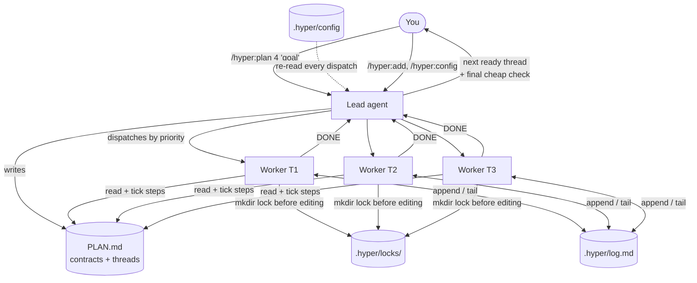

<div align="center">

# Hyperlane

**Split a build into parallel lanes. Let a swarm of Claude agents drive them. One markdown file is the truth.**


</div>

> Hyperlane is the product name; the repository, marketplace and plugin are still called `hyperdo` / `hyper`, so every command below is `/hyper:*`.

Hyperlane is a minimalist, orchestrator-style development system for [Claude Code](https://claude.com/claude-code). You describe a goal. A **lead** agent splits it into **threads** with disjoint file ownership and writes them to `PLAN.md`. Background **workers** (sub-agents) pick up threads in parallel, lock the files they touch, and talk to each other through an append-only log. No server, no database, no framework: a plugin made of a few `SKILL.md` files, a `WORKER.md` protocol, and plain text files in your repo.

## 30-second demo

```text
/hyper:init                                   # analyze repo, write CLAUDE.md, create .hyper/
/hyper:plan 4 "add OAuth login with tests"    # lead writes PLAN.md, launches up to 4 workers
/hyper:status                                 # done/total, per-thread progress, locks, log tail
/hyper:add -p 9 "fix flaky session test"      # urgent thread, starts immediately
/hyper:do --model h55 "rename foo to bar"     # fire-and-forget one-off worker
```

The lead writes a plan like this (abridged):

```markdown
# PLAN: add OAuth login

## Contracts
POST /auth/callback -> { token: string }; session type lives in src/auth/types.ts

## Threads
### T1 provider-client · p:5 · m:sonnet · owns: src/auth/provider/** · deps: — · status: doing:T1
- [x] read existing HTTP client conventions
- [ ] implement authorize/token exchange
- [ ] check: npm run typecheck

### T2 login-ui · p:5 · m:sonnet · owns: src/ui/login/** · deps: — · status: doing:T2
- [ ] build login button + callback page
- [ ] check: npm test -- login
```

While workers run, `.hyper/log.md` becomes a shared chat:

```text
[lead] ADD T3 p:9: fix flaky session test
[T1 14:02] NEED T0→all: add `expiresAt` to Session in contracts
[lead] URGENT T3
[T2 14:05] DONE: src/ui/login/**
```

## Why it is different

- **Plain files are the whole system.** `PLAN.md` (what and who), `.hyper/config` (limits), `.hyper/log.md` (conversation), `.hyper/locks/` (who is editing what), `.hyper/logs/` (full check output). Read them, edit them, commit them, delete them.
- **Disjoint ownership instead of merge conflicts.** Each thread declares `owns:` globs. Anything outside needs a lock first.
- **Locks are just `mkdir`.** `mkdir .hyper/locks/<path>` is atomic; it fails if someone else holds it. No daemon required.
- **Contracts first.** Shared interfaces go in a `## Contracts` section (or a T0 thread) so lanes never block on each other. A worker that needs a contract change posts `NEED` and stops that part; the lead decides.
- **Live control.** Change limits, rigor or model with `/hyper:config` while workers run; the lead re-reads config on every dispatch and workers see `[config] rigor=` in the log.
- **Right model per thread.** Opus for architecture and hard debugging, Sonnet for normal work, Haiku for mechanical edits, with a per-command `--model` override.
- **Small on purpose.** The lead keeps its turns tiny and never does worker work while workers run.

## Install

Requires the [`claude` CLI](https://claude.com/claude-code) and bash.

```bash
git clone <this-repo-url> hyperdo
cd hyperdo
./install.sh
```

`install.sh` does three things:

1. Copies `WORKER.md` to `~/.claude/hyperdo/WORKER.md` (the protocol every worker is told to follow).
2. Adds this directory as the `hyperdo` plugin marketplace (or updates it).
3. Installs (or updates) `hyper@hyperdo` at user scope.

Restart Claude Code afterwards. Re-run `./install.sh` after pulling changes to refresh the plugin and `WORKER.md`.

To remove: `./uninstall.sh` deletes `~/.claude/hyperdo` (and a legacy `~/.claude/skills/hyperplan`), uninstalls the plugin and removes the marketplace. It does not touch per-project state; use `/hyper:clean` in each project for that.

## Command reference

| Command | What it does |
| --- | --- |
| `/hyper:init [--defaults]` | Like `/init`, hyper-aware: analyzes the repo, writes or refreshes `CLAUDE.md`, creates `.hyper/{config,log.md,locks/,logs/}`, asks for config (or takes defaults), then offers to run `/hyper:plan`. |
| `/hyper:plan <N> "<goal>"` | Lead mode. Splits the goal into threads in `PLAN.md`, creates `.hyper/`, then orchestrates up to `N` workers by priority until all threads are done. With no args and an existing `PLAN.md`, it resumes. A new goal appends threads; it never overwrites. |
| `/hyper:add [-p N] [--model <alias>] [--split [--force]] "<task>"` | Appends a new thread with priority `N` (1-10, default 5; also `p8`, `priority 8`) and starts a worker now if deps are done and there is a free slot (or `N` >= 9). Priority 10 also logs `[lead] URGENT` so other workers release files it needs. `--split` has the lead judge whether the task splits into independent parts with disjoint files and adds one thread per part (with `deps:` where order matters); if not, it logs `[lead] NOSPLIT <why>` and adds one thread. `--split --force` always splits into 2+ parts; `--force` alone implies it. |
| `/hyper:do [--model <alias>] [--split [--force]] ["<task>"]` | With a task: fire-and-forget one worker outside `PLAN.md` (queued in the log if `max_do` is reached). With no args: drives all ready threads in `PLAN.md`. `--split` / `--split --force` work as in `/hyper:add` (one worker per part, bounded by `max_do`; `[lead] NOSPLIT` fallback to one worker). Legacy shorthands `--opus`, `--sonnet`, `--haiku` still work. |
| `/hyper:config [key=value ...]` | Sets limits, rigor, model, dev mode and the Code Mode record via a question UI, or directly with args (e.g. `rigor=slow max_workers=6`). Applies live. |
| `/hyper:status` | Done/total threads, each thread's status and step progress, held locks, last 10 log lines. Can reset a stuck `doing` thread and clear its locks on request. |
| `/hyper:clean [--keep-plan]` | Deletes `.hyper/` and (unless `--keep-plan`) `PLAN.md`, after listing everything and asking for confirmation. Refuses while workers look alive. Never touches `CLAUDE.md` or source. |

### Model aliases (`--model`)

| Alias | Model |
| --- | --- |
| `s55`, `sonnet` | Sonnet 5.5 |
| `o55`, `opus` | Opus 5.5 |
| `f52`, `fable` | Fable 5.2 |
| `h55`, `haiku` | Haiku 5.5 |

Precedence: `--model` override > thread's `m:` tag > config `model` > automatic routing.

## How it works



**Lead.** Recons the repo briefly, writes `PLAN.md`, then loops: pick ready threads (status `todo`, deps done) sorted by `p:` descending, launch up to `max_workers` minus running in one message as background agents, and launch the next one as soon as any worker finishes. At the end it runs one whole-project check (scaled by rigor) and reports done/total.

**Workers.** Each worker is told only: *you are hyper worker T<k>, follow `WORKER.md`, your thread is in `PLAN.md`.* The protocol:

1. Read `PLAN.md` (Contracts and own thread) and tail the log.
2. Claim the thread (`status: doing:T<k>`); lock any file outside `owns:` with `mkdir`.
3. Build to the Contracts, editing only owned or locked files. Contract change needed? Post `NEED T<k>→all: ...` and stop that part.
4. Collaborate by appending `[T<k> HH:MM] msg` to the log; answer `NEED`/`ASK` lines.
5. Tick steps, run checks per rigor (silent on success, output in `.hyper/logs/`), release locks on `[lead] URGENT`.
6. Finish: `rmdir` locks, `status: done` (or `blocked:<why>`), log `[T<k>] DONE: <files>`, reply to lead in at most 3 lines.

**Thread format.** `### T<k> <name> · p:<1-10> · m:<model> · owns: <globs> · deps: <ids or —> · status: <todo | doing:<worker> | done | blocked:<why>>`, optionally `shares:` for files owned elsewhere.

## Configuration

State lives in `.hyper/config` as one line of `key=value` pairs (default: `max_workers=3 max_do=2 rigor=fast model=auto dev_mode=solo code_mode=off`).

| Key | Values | Default | Meaning |
| --- | --- | --- | --- |
| `max_workers` | 1-20 | 3 | Concurrent plan workers |
| `max_do` | 0-10 | 2 | Concurrent `/hyper:do` workers (0 disables) |
| `rigor` | `fast` \| `medium` \| `slow` | `fast` | `fast` = the thread's own `check:` only; `medium` = plus tests for core logic; `slow` = tests on every change plus a self-review of the diff |
| `model` | `auto` \| `opus` \| `sonnet` \| `haiku` | `auto` | Worker model; `auto` routes by task |
| `dev_mode` | `solo` \| `pro` \| `prod` | `solo` | How workers use git; see the table below |
| `code_mode` | `on` \| `off` | `off` | Records whether Claude Code's experimental [Code Mode](https://code.claude.com/docs/en/code-mode.md) is on. Toggling it via `/hyper:init` or `/hyper:config` edits `env.CLAUDE_CODE_EXPERIMENTAL_CODE_MODE` in `~/.claude/settings.json` (after confirmation); restart claude afterwards |

Lowering limits never kills running workers; it just stops new launches.

| `dev_mode` | Git workflow |
| --- | --- |
| `solo` | Shared tree, small commits on main, `git pull --rebase` + `git push` often, no PRs (choosing it is standing approval for those pushes). |
| `pro` | Branch per thread, conventional commits, affected tests, PR via `gh`, lead merges after checks pass; never push to main. |
| `prod` | `pro` + rigor=slow, worktree per thread, fresh-context review, CI green, no force-push, CHANGELOG entry, your approval before merge/deploy. |

Code Mode caveats: experimental, interactive terminal only (not `-p`, VS Code, Desktop or cloud), needs claude >= 2.1.323 and a restart, and is set per user (project settings are ignored for it). See the [Code Mode docs](https://code.claude.com/docs/en/code-mode.md).

### Modes

- **Auto mode.** No confirmation questions: the lead and workers pick defaults and log `[lead] DEFAULT <choice>`. Destructive or outward-facing actions (force-push, deploy, deleting data, external posts) still require asking. `/hyper:clean` always confirms.
- **Plan mode.** `/hyper:plan` researches read-only, drafts the threads and presents them via ExitPlanMode; nothing is written and no worker launches until you approve. `/hyper:add`, `/hyper:do`, `/hyper:init` and `/hyper:clean` describe what they would do and exit plan mode before writing.

## FAQ

**Why is it called Hyperlane if the commands say `hyper`?** The repo, marketplace (`hyperdo`) and plugin (`hyper`) names are kept so nothing breaks. Hyperlane is the name for the system itself.

**Do I need to use git worktrees?** No. Isolation comes from disjoint file ownership and `mkdir` locks in a single working tree.

**A worker died and a thread is stuck on `doing`.** Run `/hyper:status` and tell it the worker is gone; it resets the thread to `todo` and removes its locks.

**Can I edit `PLAN.md` by hand?** Yes. It is the source of truth; the lead and workers re-read it.

**Does it test my code?** As much as `rigor` says: by default each thread runs only its own `check:` command, and the lead runs one cheap whole-project check at the end. Checks are silent on success: full output goes to `.hyper/logs/T<k>-<check>.log`, and only a failure shows its exit code, the first few error lines and the log path. Rerun with `-v`/`--verbose` or read the log for more; `/hyper:status` lists failing threads with their log paths.

**Does anything leave my machine?** The plugin is local files and Claude Code sub-agents. The installer only runs `claude plugin` commands against this directory.

## Contributing

The whole system is Markdown plus two shell scripts, so contributions are easy to review.

- Commands live in `plugins/hyper/skills/<name>/SKILL.md` (frontmatter `name` and `description`, then the instructions).
- The worker protocol is `WORKER.md`; `install.sh` copies it to `~/.claude/hyperdo/`.
- The command list is mirrored in `.claude-plugin/marketplace.json` and the `install.sh` echo line; update all three when adding a command.
- Keep it minimal: prefer fewer words in a skill, and no new moving parts without a strong reason.
- Try changes with `./install.sh` and restart Claude Code.

## License

No license file has been added yet. Add a `LICENSE` before publishing or accepting outside contributions.
