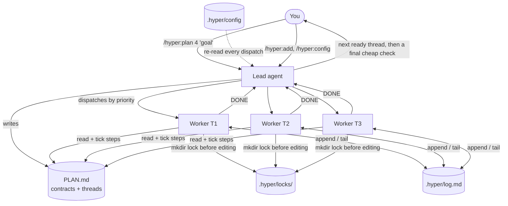

<div align="center">


# Hyperdo

**Minimal parallel agent orchestration for Claude Code. One lead plans the work as threads in PLAN.md; background workers build them side by side, coordinated by file locks and a shared log. Markdown-only state, no dependencies.**

 [](LICENSE)

**[→ The extremely serious website](https://grplyler.github.io/hyperdo/)**

</div>

Hyperdo is small on purpose. The whole plugin is 7 Markdown skill files plus one `WORKER.md` protocol, about 230 lines together, installed by a 7-line shell script. No runtime, no daemon, no server, no database: it needs only the `claude` CLI and bash. All state is plain files in your repo (`PLAN.md` and `.hyper/`) that you can read and edit by hand, and `./uninstall.sh` removes everything it installed.

You describe a goal. Hyperdo splits it into parallel **threads**, each owning a disjoint set of files, and launches background Claude agents to build them.

- **No merge conflicts by design.** Every thread declares the files it `owns:`. Touching anything else needs a lock first.
- **Agents talk to each other.** Workers post to an append-only log, ask for contract changes, and release files when something urgent comes in.
- **You stay in control.** Change worker limits, testing rigor or model while it runs. Edit `PLAN.md` by hand whenever you like.

## Install

Needs the [`claude` CLI](https://claude.com/claude-code) and bash.

```bash
git clone https://github.com/grplyler/hyperdo.git
cd hyperdo && ./install.sh
```

Restart Claude Code, then run `/hyper:init` and `/hyper:plan` in any project.

## How you'd expect it to work

```text
/hyper:init                                   # set up this repo: CLAUDE.md + .hyper/
/hyper:plan 4 "add OAuth login with tests"    # write PLAN.md, run up to 4 workers until done
/hyper:add -p 10 "fix flaky session test"     # add one thread to the plan; urgent starts now
/hyper:do "rename foo to bar"                 # one worker, right now, no plan
/hyper:status                                 # show progress; changes nothing unless asked
/hyper:config rigor=slow                      # change a setting; running work picks it up
/hyper:clean                                  # delete hyper state, after showing the list
```

## What it looks like

The plan the lead writes (abridged):

```markdown
# PLAN: add OAuth login

## Contracts
POST /auth/callback -> { token: string }; session type lives in src/auth/types.ts

## Threads
### T1 provider-client · p:5 · m:sonnet · owns: src/auth/provider/** · deps: — · status: doing:T1
- [x] read existing HTTP client conventions
- [ ] implement authorize/token exchange
- [ ] check: npm run typecheck

### T2 login-ui · p:5 · m:sonnet · owns: src/ui/login/** · deps: — · status: doing:T2
- [ ] build login button + callback page
- [ ] check: npm test -- login
```

While workers run, `.hyper/log.md` is their shared chat:

```text
[lead] ADD T3 p:10: fix flaky session test
[T1 14:02] NEED T1→all: add `expiresAt` to Session in contracts
[lead] URGENT T3
[T2] DONE: src/ui/login/**
```

## When to use it

Good fit: a feature or refactor that splits into lanes touching different files (API plus UI plus tests, a rename across packages, a docs pass alongside code).

Poor fit: a single tangled change where every step depends on the last. One agent does that better.

## How it works



- **Lead.** Skims the repo, writes `PLAN.md`, then loops: take ready threads (`todo`, deps done) by priority, launch up to `max_workers` background agents, launch the next as soon as one finishes. At the end it runs one whole-project check and reports done/total. It keeps its turns tiny and never does worker work.
- **Workers.** Each is told only: *you are hyper worker T<k>, follow `WORKER.md`, your thread is in `PLAN.md`.*
- **Contracts.** Shared interfaces go in a `## Contracts` section (or a T0 thread) so lanes never block on each other. A worker that needs a change posts `NEED` and stops that part; the lead decides.
- **Locks are `mkdir`.** `mkdir .hyper/locks/<path>` is atomic and fails if someone else holds it. No daemon.
- **Model per thread.** Opus for architecture and hard debugging, Sonnet for normal work, Haiku for mechanical edits. Override per command with `--model`.

The worker protocol, in short:

1. Read `PLAN.md` (Contracts and own thread) and tail the log.
2. Claim the thread (`status: doing:T<k>`); lock any file outside `owns:`.
3. Build to the Contracts; need a change? Post `NEED T<k>→all: ...` and stop that part.
4. Append `[T<k> HH:MM] msg` to the log; answer `NEED`/`ASK` lines.
5. Tick steps and run checks per rigor. Checks are silent on success; full output goes to `.hyper/logs/T<k>-<check>.log`.
6. Finish: release locks, `status: done` (or `blocked:<why>`), log `[T<k>] DONE: <files>`, reply to the lead in at most 3 lines.

### Phases

Automatic, and only for long plans (more than four threads across several dependency levels): the lead groups threads into milestones, each with a gate. You never assign them.

```markdown
## Phase 2 api
gate: npm test -- api
```

When a phase's last thread finishes, the lead runs the gate once and logs `[lead] PHASE 2 DONE` (or `PHASE 2 FAIL <log>` plus a fix thread). Only threads that depend on that phase wait for its gate; everything else keeps running. `/hyper:status` collapses done phases to one line. Add `· hold` to a phase heading to keep its threads from starting. Small plans stay flat.

Thread format: `### T<k> <name> · p:<1-10> · m:<model> · owns: <globs> · deps: <ids or —> · status: <todo | doing:<worker> | done | blocked:<why>>`, plus optional `shares:` for files owned elsewhere.

## Commands

| Command | What it does |
| --- | --- |
| `/hyper:init [--defaults]` | Like `/init`, hyper-aware: writes or refreshes `CLAUDE.md`, creates `.hyper/`, asks for config (or takes defaults), then offers to run `/hyper:plan`. |
| `/hyper:plan <N> "<goal>"` | Splits the goal into threads in `PLAN.md` and runs up to `N` workers until all are done. No args with an existing `PLAN.md` resumes. A new goal appends; it never overwrites. |
| `/hyper:add [-p N] [--model <alias>] [--split [--force]] "<task>"` | Adds a thread with priority `N` (1-10, default 5) and starts a worker now if deps are done and a slot is free (or `N` >= 9). Priority 10 also logs `[lead] URGENT` so other workers release files it needs. |
| `/hyper:do [--model <alias>] [--split [--force]] ["<task>"]` | With a task: one fire-and-forget worker outside `PLAN.md` (queued if `max_do` is reached). With no args: drives all ready threads in `PLAN.md`. |
| `/hyper:config [key=value ...]` | Sets limits, rigor, model, dev mode and the Code Mode record via a question UI, or directly (`rigor=slow max_workers=6`). Applies live. |
| `/hyper:status` | Done/total, each thread's status and step progress, held locks, last 10 log lines, failing checks with log paths. Can reset a stuck `doing` thread on request. |
| `/hyper:clean [--keep-plan]` | Deletes `.hyper/` and, unless `--keep-plan`, `PLAN.md`, after listing everything and asking. Refuses while workers look alive. Never touches `CLAUDE.md` or source. |

**`--split`** (on `add` and `do`) lets the lead judge whether the task is 2+ independent parts with disjoint files and runs one thread or worker per part. If it is not, it logs `[lead] NOSPLIT <why>` and runs one. `--split --force` always splits into 2+ parts along the best seam; `--force` alone implies it.

**`--model`** aliases (precedence: `--model` > thread's `m:` tag > config `model` > automatic routing):

| Alias | Model |
| --- | --- |
| `s55`, `sonnet` | Sonnet 5.5 |
| `o55`, `opus` | Opus 5.5 |
| `f52`, `fable` | Fable 5.2 |
| `h55`, `haiku` | Haiku 5.5 |

`/hyper:do` also still accepts the legacy `--opus`, `--sonnet` and `--haiku`.

## Configuration

`.hyper/config` is one line of `key=value` pairs. Default: `max_workers=3 max_do=2 rigor=fast model=auto dev_mode=solo code_mode=off`.

| Key | Values | Default | Meaning |
| --- | --- | --- | --- |
| `max_workers` | 1-20 | 3 | Concurrent plan workers |
| `max_do` | 0-10 | 2 | Concurrent `/hyper:do` workers (0 disables) |
| `rigor` | `fast` \| `medium` \| `slow` | `fast` | `fast`: the thread's own `check:` only. `medium`: plus tests for core logic. `slow`: tests on every change plus a self-review of the diff. |
| `model` | `auto` \| `opus` \| `sonnet` \| `haiku` | `auto` | Worker model; `auto` routes by task |
| `dev_mode` | `solo` \| `pro` \| `prod` | `solo` | How workers use git (below) |
| `code_mode` | `on` \| `off` | `off` | Records whether Claude Code's experimental [Code Mode](https://code.claude.com/docs/en/code-mode.md) is on (see below) |

Lowering limits never kills running workers; it only stops new launches.

| `dev_mode` | Git workflow |
| --- | --- |
| `solo` | Shared tree, small commits on main, `git pull --rebase` and `git push` often, no PRs. Choosing it is your standing approval for those pushes. |
| `pro` | Branch per thread, conventional commits, affected tests, PR via `gh`; the lead merges after checks pass. Never pushes to main. |
| `prod` | `pro` plus rigor=slow, a worktree per thread, fresh-context review, CI green, no force-push, a CHANGELOG entry, and your approval before merge or deploy. |

**Code Mode.** Toggling `code_mode` in `/hyper:init` or `/hyper:config` edits `env.CLAUDE_CODE_EXPERIMENTAL_CODE_MODE` in `~/.claude/settings.json`, always after confirmation, and needs a claude restart. It is experimental, interactive-terminal only (not `-p`, VS Code, Desktop or cloud), needs claude >= 2.1.323, and project settings are ignored for it. See the [docs](https://code.claude.com/docs/en/code-mode.md).

**Auto mode and plan mode.** In auto mode, no confirmation questions: defaults are picked and logged as `[lead] DEFAULT <choice>`, but destructive or outward-facing actions (force-push, deploy, deleting data) still need your OK, and `/hyper:clean` always confirms. In plan mode, `/hyper:plan` researches read-only and shows the threads via ExitPlanMode; nothing is written and no worker starts until you approve. The other commands describe what they would do and exit plan mode before writing.

## FAQ

**Why do the commands say `hyper`?** The plugin is named `hyper`; the repo and marketplace are `hyperdo`. Commands are namespaced by plugin.

**Do I need git worktrees?** No. Isolation comes from disjoint file ownership and `mkdir` locks in one working tree. (`prod` mode does use a worktree per thread.)

**A worker died and its thread is stuck on `doing`.** Run `/hyper:status` and tell it the worker is gone; it resets the thread to `todo` and removes the locks.

**Can I edit `PLAN.md` by hand?** Yes. It is the source of truth and the lead and workers re-read it.

**Does it test my code?** As much as `rigor` says. By default each thread runs only its own `check:`, and the lead runs one cheap whole-project check at the end. Passing checks print nothing; on failure you get the exit code, the first few error lines and a log path. Rerun with `-v`/`--verbose` or read `.hyper/logs/` for more.

**What does it send where?** Hyperdo adds no network calls of its own. The agents talk to Claude as usual, and in `solo` mode workers `git push` to your `origin`. The installer only runs `claude plugin` commands against this directory.

**Do I have to manage phases?** No. They are automatic and optional: the lead adds them only to long plans and files new threads into the right one.

**How do I remove it?** `./uninstall.sh` removes `~/.claude/hyperdo`, the plugin and the marketplace. Per-project state stays; run `/hyper:clean` in each project for that.

## Contributing

The whole system is Markdown plus two short shell scripts, so changes are easy to review.

- Commands live in `plugins/hyper/skills/<name>/SKILL.md` (frontmatter `name` and `description`, then the instructions).
- The worker protocol is `WORKER.md`; `install.sh` copies it to `~/.claude/hyperdo/`. Re-run `./install.sh` after changing it.
- The command list is mirrored in `.claude-plugin/marketplace.json` and the `install.sh` echo line; update all three when adding a command.
- Keep it minimal: fewer words in a skill, and no new moving parts without a strong reason.

## License

MIT — see [LICENSE](LICENSE).
